  

## About me

I’m Franc. I build tools for Discord communities and enjoy working across the backend and the interface. I’m interested in permission systems, persistent workflows, and making complex settings easy to use.

## Stack

  

## GitHub activity

[Read the chart data](./data/activity-summary.md) · [View my full contribution history](https://github.com/francLunevro#contribution-activity)

---

[GitHub profile](https://github.com/francLunevro) · [Public repositories](https://github.com/francLunevro?tab=repositories)
