  

## About me

I’m Franc. I build tools for Discord communities and enjoy working across the backend and the interface. I’m interested in permission systems, persistent workflows, and making complex settings easy to use.

## Stack

  

## Featured project

Vigil brings case-based moderation, automod, searchable logs, ticket transcripts, and temporary voice controls into one Discord bot. One Node.js process runs the bot and serves the React dashboard through Express. SQLite stores its data.

[View source and setup](https://github.com/francLunevro/Vigil-the-only-needed-bot) · [View Vigil CI](https://github.com/francLunevro/Vigil-the-only-needed-bot/actions/workflows/ci.yml)

## GitHub activity

The charts track Vigil’s public default-branch commits and GitHub’s language breakdown. [Read the chart data](./data/activity-summary.md) · [View my full contribution history](https://github.com/francLunevro#contribution-activity)

---

[GitHub profile](https://github.com/francLunevro) · [Public repositories](https://github.com/francLunevro?tab=repositories)
