I build software for Discord communities. I like the work that sits between server logic and the screen someone needs to use: permissions, records, and settings.

## Vigil

Vigil is a self-hosted Discord bot with a web dashboard for moderation and support. Ticket transcripts keep the conversation available after the channel closes.

## What I work with

**Bot and API** · JavaScript, Node.js, discord.js, Express, SQLite  
**Dashboard** · React, Vite  
**Build and deployment** · GitHub Actions, Docker

[Contribution history](https://github.com/francLunevro#contribution-activity) · [Public repositories](https://github.com/francLunevro?tab=repositories)
